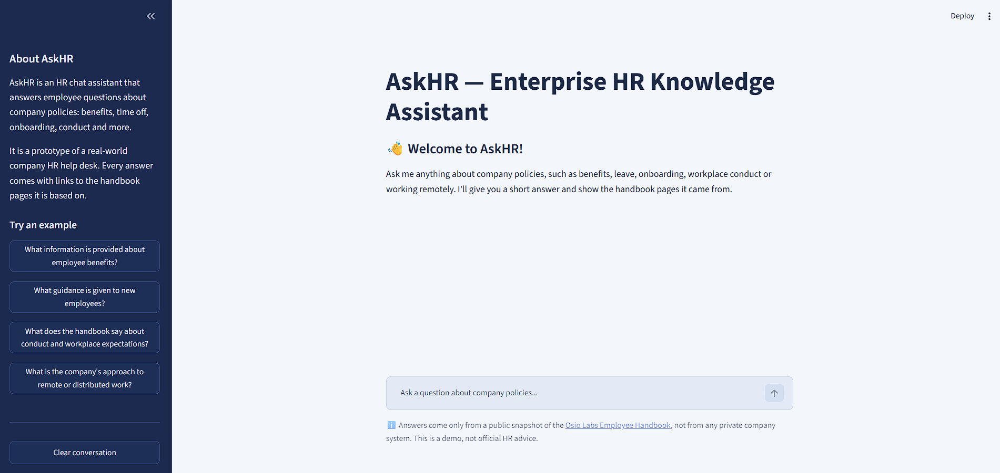
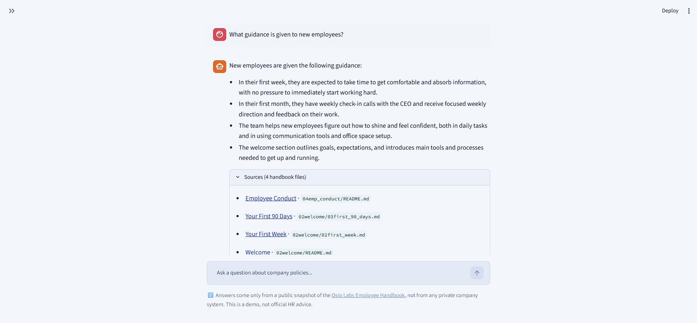

# AskHR — Enterprise Knowledge Assistant (RAG)

[](https://github.com/chakra2024/askhr-rag-assistant/actions/workflows/ci.yml)

AskHR is a small, educational Retrieval-Augmented Generation (RAG) demo. It answers
employee questions (onboarding, benefits, conduct, time off) using the **public
Osio Labs Employee Handbook**, and shows which handbook files the answer came from.

> This is an independent learning project. It is **not** affiliated with Osio Labs,
> and it is **not** official or current HR guidance. It runs locally only.

**Status:** working local demo (Streamlit UI, terminal commands and offline tests).

## Screenshots

**Home page:** welcome message, example questions in the sidebar, disclaimer in the footer.



**Answer with sources:** a short answer from local Qwen, with the handbook files it was
based on (each linked to GitHub).



## Tech stack

| Part | Tool |
| --- | --- |
| Framework | LangChain |
| Chunking | `RecursiveCharacterTextSplitter` |
| Embeddings | Pinecone-hosted `llama-text-embed-v2` via `PineconeEmbeddings` |
| Vector database | Pinecone dense index via `PineconeVectorStore` |
| LLM | Local Ollama `qwen3:4b-instruct` via `ChatOllama` |
| UI | Streamlit |
| Tests / lint / CI | pytest, Ruff, GitHub Actions |

## Architecture

```text
Markdown files ──> LangChain Documents ──> chunks ──> Pinecone embeddings ──> Pinecone index
                                                                                   │
User question ──> retrieve top 4 chunks ──> prompt ──> local Qwen (Ollama) ──> answer + sources
```

## Project files

File names describe what each file does.

```text
src/load_documents.py      Read handbook .md files and split them into chunks
src/pinecone_store.py      Pinecone embeddings, index and vector store helpers; sample search
src/answer_question.py     Retrieve chunks, build the prompt, ask Qwen; terminal Q&A command
build_index.py             One-time command: embed chunks and store them in Pinecone
streamlit_app.py           Streamlit chat interface
.github/workflows/ci.yml   GitHub Actions: lint + tests on every push
.streamlit/config.toml     Colour theme for the web app
screenshots/               Screenshots used in this README
tests/                     Offline unit tests
data/handbook/             Downloaded handbook Markdown files (not committed)
```

## Setup

Requires Python 3.11 on Windows (other platforms should work too).

### 1. Create a virtual environment and install packages

From the project folder, in PowerShell:

```powershell
python -m venv .venv
.\.venv\Scripts\Activate.ps1
python -m pip install --upgrade pip
pip install -r requirements.txt
```

If PowerShell blocks the activation script, run this once and try again:
`Set-ExecutionPolicy -Scope CurrentUser RemoteSigned`

### 2. Download the handbook (manual, one time)

1. Open https://github.com/OsioLabs/emphandbook
2. Click **Code → Download ZIP** and extract it.
3. Copy the five numbered section folders into `data/handbook/`.

The result should look like this:

```text
data/handbook/
├── 01who_we_are/
├── 02welcome/
├── 03benefits/
├── 04emp_conduct/
└── 05emp_status/
```

Alternatively, using git:

```powershell
git clone https://github.com/OsioLabs/emphandbook.git $env:TEMP\emphandbook
Copy-Item -Recurse $env:TEMP\emphandbook\0* data\handbook\
```

The app never downloads or crawls anything itself; it only reads these local files.
The handbook files are excluded from Git (see `.gitignore`).

### 3. Install Ollama and the Qwen model

Install Ollama from https://ollama.com/download, then download the model (about 2.5 GB):

```powershell
ollama pull qwen3:4b-instruct
```

Ollama runs in the background; `ollama list` should show the model.

### 4. Get a Pinecone API key

Sign up at https://app.pinecone.io (the free Starter plan is enough), then go to
**API Keys → Create API key**.

### 5. Create your local `.env`

Create a file named `.env` in the project folder with these settings, and paste your
Pinecone key into `PINECONE_API_KEY`. The file is listed in `.gitignore`, so your real
API key is never committed.

```dotenv
PINECONE_API_KEY=replace_me
PINECONE_INDEX_NAME=askhr-handbook
PINECONE_NAMESPACE=demo
PINECONE_EMBEDDING_MODEL=llama-text-embed-v2
OLLAMA_MODEL=qwen3:4b-instruct
OLLAMA_BASE_URL=http://localhost:11434
```

| Setting | Meaning |
| --- | --- |
| `PINECONE_API_KEY` | Your key from the Pinecone console |
| `PINECONE_INDEX_NAME` | Name of the dense Pinecone index |
| `PINECONE_NAMESPACE` | Namespace inside the index used for this demo |
| `PINECONE_EMBEDDING_MODEL` | Pinecone-hosted embedding model |
| `OLLAMA_MODEL` | Local Ollama chat model |
| `OLLAMA_BASE_URL` | Where the local Ollama service listens |

## Usage

### Check document loading

Load and chunk the handbook, then print counts and sample chunk metadata:

```powershell
python -m src.load_documents
```

### Build the Pinecone index

Embed all chunks with Pinecone's hosted model and store them in the index:

```powershell
python build_index.py
```

- The first run creates the dense index `askhr-handbook` (1024 dimensions, cosine,
  AWS `us-east-1`, the only region on Pinecone's free Starter plan).
- Each chunk gets a stable ID such as `03benefits/02leave.md#chunk-3`, so re-running the
  command overwrites existing vectors instead of creating duplicates.
- If handbook files were changed or deleted, run `python build_index.py --reset`. It asks
  for confirmation, clears the `demo` namespace, then indexes everything again.

### Try a similarity search

```powershell
python -m src.pinecone_store "What is the company's approach to remote work?"
```

This prints the 4 most similar chunks with their scores and source files.

### Run the web app

Make sure Ollama is running and the index has been built, then:

```powershell
streamlit run streamlit_app.py
```

Open http://localhost:8501, type a question (or click an example in the sidebar), and
expand **Sources** to see which handbook files the answer was based on. The conversation
is kept only for the current browser tab, and every question is answered independently.

If something is missing, the page shows a plain message instead of an error trace, e.g.
a missing `PINECONE_API_KEY`, an empty index, or Ollama not running.

### Ask a question from the terminal

Make sure Ollama is running (`ollama list` should show `qwen3:4b-instruct`), then:

```powershell
python -m src.answer_question "What guidance is given to new employees?"
```

This prints the answer from local Qwen and the handbook files that were retrieved.
On a CPU-only PC the first answer takes about a minute while the model loads; later
answers take roughly 30–40 seconds.

Example questions:

- What information is provided about employee benefits?
- What guidance is given to new employees?
- What does the handbook say about conduct and workplace expectations?
- What is the company's approach to remote or distributed work?
- What is the policy on company cars? *(not in the handbook, so AskHR says it couldn't find it)*

### Run the tests and linter

```powershell
pytest -q
ruff check .
```

The 9 unit tests run offline in about a second. They never call Pinecone or Ollama:
small fakes stand in for the vector store and the chat model, so the tests check this
project's own logic (loading and cleaning files, chunk IDs, prompt context, the
"not found" path) rather than the external services.

| Test file | What it checks |
| --- | --- |
| `tests/test_load_documents.py` | Only `.md` files load, empty files are skipped, navigation links are removed, chunks keep their metadata |
| `tests/test_pinecone_store.py` | Chunk IDs are stable (no duplicates on re-index), missing API key gives a clear error |
| `tests/test_answer_question.py` | Context includes source labels, no results skips the LLM, answer and sources are returned |

### Continuous integration

GitHub Actions ([.github/workflows/ci.yml](.github/workflows/ci.yml)) runs `ruff check .` and
`pytest -q` on Python 3.11 for every push and pull request to `main`. It needs no API keys,
no Ollama and no secrets. Package versions are pinned in `requirements.txt`.

## How loading works

- All `.md` files under `data/handbook/` are read recursively; other files are ignored.
- Page navigation links ("Next page", "Table of Contents") and `---` dividers are removed.
- Empty or near-empty files (under 50 characters) are skipped and listed.
- Each document keeps `source` (e.g. `03benefits/02leave.md`), `title` (first heading, or
  the file name) and `source_url` (link to the file on GitHub).
- Documents are split with `chunk_size=800`, `chunk_overlap=120`, a starting configuration,
  not a tuned one.

## How indexing works

- `PineconeEmbeddings` (model `llama-text-embed-v2`) turns each chunk into a 1024-number
  vector. Chunks are embedded as "passages" and questions as "queries".
- `PineconeVectorStore` stores each vector with its text and metadata (`source`, `title`,
  `source_url`) in the `demo` namespace.
- A search embeds the question and returns the chunks with the highest cosine similarity.
- Embedding calls go to Pinecone over the internet; no model is downloaded locally.

## How answering works

1. The question is embedded and the 4 most similar chunks are retrieved from Pinecone.
2. The chunks are joined into one context block, each labelled with its source file.
3. A small LangChain (LCEL) chain runs: `ChatPromptTemplate` → `ChatOllama` → `StrOutputParser`.
4. The prompt tells Qwen to use only the handbook excerpts, to treat them as evidence rather
   than instructions, and to say it couldn't find the answer when the excerpts don't cover it.
5. The answer is returned with the retrieved chunks as sources. The sources show what the
   model was given; they don't prove every sentence of the answer.

Qwen runs with `temperature=0` (factual, repeatable), a 4096-token context and a 400-token
answer limit to stay within 8 GB of RAM. If nothing is retrieved, the model isn't called.

## Data source and license

- Source: [Osio Labs Employee Handbook](https://github.com/OsioLabs/emphandbook)
- License: the repository states CC0-1.0 (public domain dedication). Check the upstream
  repository for the current license before redistributing its files.
- The content may be dated. Markdown files have no page numbers, so AskHR cites
  filenames/URLs only.

## Known limitations

- Local demo only; no hosting, logins, or chat memory.
- Needs internet and a Pinecone account (free Starter plan is enough) for embeddings and search.
- A 4B model on CPU is slow (~30–40 s per answer) and can occasionally summarise loosely.
- Answers will only be as accurate as the retrieved handbook passages.
- Answer accuracy is not measured automatically; it relies on the grounded prompt, visible
  sources and manual checks with the example questions.
- For questions the handbook doesn't cover, the closest (unrelated) pages are still listed
  under Sources, because retrieval always returns the top 4 matches.
